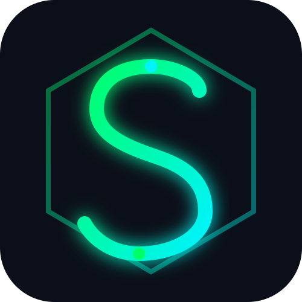

# ⚡ SPLAYED ($SPL) — Next-Gen Decentralized Global Currency
# ⚡ SPLAYED ($SPL) — Next-Gen Decentralized Layer-1 Currency

<p align="center">
  
</p>

<p align="center">
  <b>Inspired by Bitcoin. Engineered for absolute financial freedom, supreme scalability, and strict scarcity.</b>
</p>

---

## 🌐 Overview
**SPLAYED ($SPL)** is an independent, decentralized Layer-1 blockchain network (The Splaychain) governed by a strict fixed supply model and Proof-of-Work (PoW) consensus. Designed to eliminate intermediaries and offer absolute sovereignty to its global user base.

- **Ticker:** $SPL
- **Max Total Supply:** 21,000,000 (Strictly Capped)
- **Consensus:** Proof-of-Work (SHA-256 Engine)
- **Official Website:** [https://mranonnymous-27.github.io/splayed-network/](https://mranonnymous-27.github.io/splayed-network/)

---

## 📂 Repository Architecture

- `index.html` — Official decentralized landing page & Testnet Faucet widget.
- `logo.svg` — Official Vector Brand Identity ("S-Curve Neon Glow").
- `splayed_core.py` — Core blockchain ledger and PoW mining algorithm.
- `miner.py` — Interactive CLI Miner client.
- `wallet.py` — Cryptographic key & secure wallet address generator.
- `node_server.py` — Flask-powered P2P node and transaction broadcasting server.
- `WHITEPAPER.md` — Comprehensive technical architecture specification.

---

## 💻 Running a Splaychain Node & Miner

To participate in the Splayed network, clone this repository and run the core modules locally:

### 1. Generate Your Secure Wallet
Create your cryptographic public address (`spl1q...`) and private key:
```bash
python wallet.py


**SPLAYED ($SPL)** is a decentralized, ultra-scalable, and secure Layer-1 digital cryptocurrency engineered for global economic independence and absolute monetary scarcity.

---

## 🌐 Official Channels
* **Website:** [Live Landing Page](https://mranonnymous-27.github.io/splayed/)
* **Ticker Symbol:** `$SPL`
* **Network Type:** Independent Layer-1 (Splaychain)

---

## 💎 Core Tokenomics

| Parameter | Specification |
| :--- | :--- |
| **Asset Name** | SPLAYED |
| **Ticker** | `$SPL` |
| **Max Supply** | 21,000,000 $SPL |
| **Smallest Unit** | 1 $SPL = 100,000,000 Splay / Plaid |
| **Consensus** | Eco-friendly Proof of Stake (PoS) / DPoS |
| **Block Time** | Fast Transaction Settlement |

---

## 🚀 Development Roadmap

- [x] **Phase 1:** Concept Design, Brand Identity & Tokenomics
- [x] **Phase 2:** Official Web Interface & Public Infrastructure Setup
- [ ] **Phase 3:** Whitepaper Release (v1.0) & Architecture Documentation
- [ ] **Phase 4:** Core Splaychain Testnet Deployment & Security Audits
- [ ] **Phase 5:** Mainnet Launch, Wallet Release & Global DEX/CEX Listing

---

© 2026 SPLAYED Foundation. All Rights Reserved.
